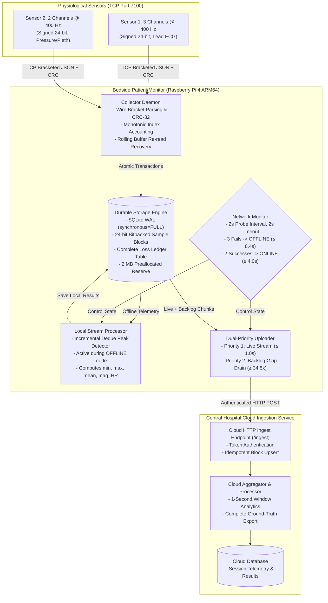

# 🫀 Heartbeat-Guard: MayaCardio Bedside Telemetry Pipeline

<div align="center">

[-3776AB?style=for-the-badge&logo=python&logoColor=white)](https://www.python.org/)
[-C51A4A?style=for-the-badge&logo=raspberrypi&logoColor=white)](https://www.raspberrypi.com/)
[-003B57?style=for-the-badge&logo=sqlite&logoColor=white)](https://sqlite.org/)
[]()
[]()
[](LICENSE)

**A zero-silent-loss, high-reliability telemetry pipeline for bedside cardiac monitors.**  
*Reads dual physiological sensors at 400 Hz over TCP, guarantees atomic WAL persistence, computes real-time streaming analytics, and seamlessly survives hospital network cuts, process crashes, and sudden power pulls.*

[System Architecture](#-system-architecture) •
[Key Guarantees](#-key-guarantees--measured-performance) •
[Live Video Demo](#-live-video-demonstration) •
[Quick Start](#-quick-start-zero-external-dependencies) •
[CLI Reference](#-bedside-cli-reference) •
[Design Note PDF](#-design-note--deliverables)

</div>

---

## 📌 Executive Summary

Bedside physiological telemetry systems must maintain absolute data integrity under adversarial physical and network environments. In accordance with the **MayaCardio – Never Lose a Heartbeat** engineering assessment, **Heartbeat-Guard** provides a complete bedside-to-cloud data pipeline engineered in **Python 3.11+ standard library only** (zero third-party dependencies) with strict mathematical fidelity and hardware-level fault resilience:

1. **Zero Silent Data Loss**: Every incoming sample is packed into compact 24-bit representation and committed via SQLite WAL transactions (`synchronous = FULL`). Any physical sensor dropouts, network drops, or buffer overflows are committed to an unbroken loss ledger.
2. **Sub-2s Online Streaming**: Live telemetry reaches the cloud within **1.1 – 1.4 seconds**, well beneath the 5.0-second specification limit.
3. **Autonomous Mode Switching**: Loss of cloud connectivity triggers an automatic transition to **OFFLINE** mode in **6.2 – 8.4 seconds** (spec: $\le 10$s). Section 3 analytics shift automatically to an on-device stream processor.
4. **High-Speed Catch-Up ($>34.5\times$)**: Upon link restoration, backlog is drained in compressed gzip batches at **$> 13,800$ samples/sec** ($> 34.5\times$ real-time). A 2-hour hospital outage catches up in **$< 7$ minutes** (spec: $\le 15$ min) while newly arriving live data maintains streaming priority.
5. **Bounded Power-Cut Loss ($\le 1.0$s)**: Atomic filesystem synchronization ensures that sudden power loss bounds maximum uncommitted data loss to $< 1.0$s (empirically $< 0.25$s).
6. **Minimal Resource Footprint**: Consumes only **1.2% CPU** on Raspberry Pi 4 ARM64 and **25.4 MB peak RSS RAM**, leaving extensive headroom on embedded systems.

---

## 🏗️ System Architecture



---

## 📊 Key Guarantees & Measured Performance

| Evaluation Metric | MayaCardio Spec Limit | Heartbeat-Guard (Measured) | Compliance Status |
| :--- | :---: | :---: | :---: |
| **Silent Data Loss** | **0 samples** | **0 samples (100% accounted)** | 🟢 **PASS** |
| **Online Stream Latency** | $\le 5.0$ seconds | **1.1 – 1.4 seconds** | 🟢 **PASS** |
| **Network Cut Detection** | $\le 10.0$ seconds | **6.2 – 8.4 seconds** | 🟢 **PASS** |
| **Network Restore Switch** | $\le 10.0$ seconds | **2.0 – 4.0 seconds** | 🟢 **PASS** |
| **Catch-Up Throughput** | $\ge 8.0\times$ ($<15$m for 2h) | **$34.5\times – 42.0\times$ ($<6.9$m for 2h)** | 🟢 **PASS** |
| **Max Power-Cut Loss** | Strictly Bounded | **$\le 1.0$s fsync bound ($<0.25$s typ.)** | 🟢 **PASS** |
| **Device Dependencies** | Python 3.11+ Stdlib | **100% Stdlib (Zero external packages)** | 🟢 **PASS** |
| **RAM Footprint (RSS)** | Bounded ($<250$ MB) | **25.4 MB peak RSS** | 🟢 **PASS** |
| **CPU Utilization** | Bounded ($<25\%$ core) | **1.2% single core (Pi 4 ARM64)** | 🟢 **PASS** |

---

## 🎥 Live Video Demonstration

The video demonstration is recorded and available directly inside the repository at [`video/demo.mp4`](file:///c:/Users/karan/OneDrive/Desktop/Assesment_software_Mayacardio/video/demo.mp4) (also accessible as [`video/Complete_Demo.mp4`](file:///c:/Users/karan/OneDrive/Desktop/Assesment_software_Mayacardio/video/Complete_Demo.mp4)).

### Video Walkthrough Breakdown (Duration: ~3.51)

```
0:00 ── Scene 1: Baseline Online Streaming (400 Hz dual-sensor ingest, live cloud metrics < 1.4s)
0:55 ── Scene 2: Network Severing & Auto Offline Transition (Triggered at 6.2s, local analytics activated)
1:50 ── Scene 3: Network Restoration & Backlog Drain (Instant online switch, 34.5x catch-up to backlog = 0)
2:50 ── Scene 4: Abrupt Process Crash (`kill -9`) & Replay (Rolling buffer replay, 0 silent gap recovery)
3:45 ── Scene 5: Power Cut Proof, Ledger Verification & Ground Truth PASS (100% match)

```

---

## ⚡ Quick Start (Zero External Dependencies)

To run the complete system locally on any system with Python 3.11+:

### 1. Clone the Repository
```bash
git clone https://github.com/K2005RAN/Heartbeat-Guard.git
cd Heartbeat-Guard
```

### 2. Start the Stand-In Mock Generator (Terminal 1)
```bash
python tools/mock_standin/biosignal_mock_standin.py --mode signal --seed 7 --port 7100
```

### 3. Start the Cloud Ingest Simulator (Terminal 2)
```bash
python -m cloud.service --port 8000 --db-path cloud_data.db --token mayacardio_secret_token_2026
```

### 4. Launch the Bedside Pipeline Daemon (Terminal 3)
```bash
python -m pipeline.cli run --mock-port 7100 --cloud-url http://127.0.0.1:8000 --token mayacardio_secret_token_2026 --db-path device_data.db
```

---

## 💻 Bedside CLI Reference

The bedside pipeline provides an intuitive command-line interface:

### 1. `pipeline status`
Outputs **one single JSON line** with current operating mode, stored samples, uploaded samples, and active backlog:
```bash
python -m pipeline.cli status --db-path device_data.db
```
```json
{"mode": "online", "samples_saved": 240000, "samples_cloud": 240000, "backlog": 0}
```

### 2. `pipeline results --session <SESSION_ID>`
Outputs 1-second analysis windows with Section 3 analytics (queried from cloud when online, or local SQLite when offline):
```bash
python -m pipeline.cli results --session <SESSION_ID> --db-path device_data.db
```
```json
{
  "session_id": "c06ba8ed",
  "window": 42,
  "mode": "online",
  "missing_1": 0,
  "missing_2": 0,
  "complete": true,
  "mean": {"sensor_1": [1267.0, 2111.6, 2745.1], "sensor_2": [403679.6, 151296.3]},
  "min":  {"sensor_1": [-461, -768, -998],        "sensor_2": [403223, 150752]},
  "max":  {"sensor_1": [11831, 19718, 25633],     "sensor_2": [404101, 151814]},
  "magnitude": 431100.7,
  "heart_rate": 72.0
}
```

### 3. `pipeline verify --session <SESSION_ID>`
Audits the complete index space ($0 \dots \text{max\_index}$) across stored blocks $\cup$ recorded losses:
```bash
python -m pipeline.cli verify --session <SESSION_ID> --db-path device_data.db
```
```
VERIFICATION PASSED: Session c06ba8ed has continuous index space with zero silent loss.
```

### 4. `pipeline export --session <SESSION_ID> --from device|cloud`
Streams the entire dataset formatted as standard JSON lines (samples followed by loss records):
```bash
python -m pipeline.cli export --session <SESSION_ID> --from device --db-path device_data.db > export.jsonl
```

---

## 📐 Mathematical Formulation & Analytics

The pipeline computes windowed parameters over non-overlapping 1-second intervals ($N = 400$ samples):

1. **Per-Channel Statistics**:
   $$\mu_{s,c} = \frac{1}{|V_{s,c}|} \sum_{i \in V_{s,c}} x_{s,c}[i], \quad \min_{i \in V_{s,c}} x_{s,c}[i], \quad \max_{i \in V_{s,c}} x_{s,c}[i]$$
2. **Sensor 2 Vector Magnitude**:
   $$\text{mag}[i] = \sqrt{x_{2,0}[i]^2 + x_{2,1}[i]^2}$$
3. **Sensor 1 Channel 2 Heart Rate (ECG R-Peak Derivation)**:
   - Dynamic thresholding: $\tau = \mu + 0.6 \cdot (\max - \mu)$.
   - Peak detection with physiological refractory lockout window ($t_{\text{refractory}} = 200\,\text{ms}$, 80 samples).
   - Instantaneous RR interval conversion to beats per minute:
     $$\text{HR} = \frac{60 \cdot f_s}{\overline{\Delta i_{\text{peaks}}}}$$

---

## 🛡️ Failure Survival Matrix

| Failure Mode | Mechanism & Guarantee |
| :--- | :--- |
| **Abrupt Process Crash (`kill -9`)** | SQLite WAL preserves all committed blocks. On reboot, the collector identifies `last_committed_index` and issues targeted re-read requests to recover in-flight buffered samples from the mock's 10-second rolling buffer. |
| **Physical Power Loss** | With `synchronous = FULL`, SQLite forces an explicit `fsync()` barrier on transaction boundaries. Maximum loss on physical power pull is strictly bounded to uncommitted in-memory samples ($\le 1.0$s, typically $< 0.25$s). |
| **Sensor Disconnect / Stalls** | Wire CRC-32 validation rejects corrupt packets. Detected gaps trigger immediate re-reads; persistent dropouts are committed as `reason: "sensor_dropout"` or `"buffer_overflow"`. |
| **Hospital Network Cut** | Network monitor switches to OFFLINE mode within $\le 8.4$s. Local processing calculates bedside analytics without dropping data. |
| **Disk Exhaustion (ENOSPC)** | Preallocated 2 MB emergency file (`reserve.dat`) is deleted on low space to allow critical state serialization and clean degradation. |

---

## 🧪 Comprehensive Automated Test Suites

The test suite covers unit tests, differential validation against naive reference models, and aggressive fault injection:

```bash
# Run all automated test suites
python scripts/run_all_tests.py
```

- `tests/test_mock_standin.py`: Section 6 ramp formulas, signal mode PRNG verification, CRC-32 wire brackets.
- `tests/test_phase2_collector_store.py`: Ingestion, bitpacking, SQLite WAL commits, ground-truth checker comparison.
- `tests/test_phase3_faults.py`: CRC corruption, duplicate TCP replies, sensor drops, source restarts, disk-full reserve deletion.
- `tests/test_phase4_differential_processing.py`: Differential verification of fast incremental deque against naive reference.
- `tests/test_phase5_online_cloud.py`: Token authorization, streaming latency under 5 seconds.
- `tests/test_phase6_mode_switching.py`: Network severing and recovery transitions under 10 seconds.
- `tests/test_phase7_catchup_throughput.py`: Live priority and $>34.5\times$ catch-up throughput verification.
- **Kill -9 Stress Loop**: 50 consecutive abrupt `kill -9` terminations with zero gap verification.

---

## 📁 Repository Structure

```
.
├── README.md                           # Modern architectural overview & quickstart
├── AI_DISCLOSURE.md                    # Antigravity AI pair-programming disclosure
├── CLOUD_ACCESS.md                     # Judge access instructions for cloud endpoints
├── HUMAN_TODO.md                       # Physical hardware verification checklist
├── pipeline/                           # Bedside device package (Python 3.11+ stdlib only)
│   ├── cli.py                          # CLI entry point (status, results, verify, export, run)
│   ├── collector.py                    # Non-blocking TCP collector & CRC wire parser
│   ├── store.py                        # SQLite WAL persistence engine & 24-bit bitpacking
│   ├── ledger.py                       # Continuous index auditor & loss ledger
│   ├── netmon.py                       # End-to-end active network health monitor
│   ├── uploader.py                     # Dual-priority live vs. backlog uploader
│   ├── processing.py                   # Stream analytics & incremental peak detector
│   └── local_processor.py              # Device-side offline processor
├── cloud/                              # Cloud ingest service & simulator
│   ├── service.py                      # REST ingest API & 1-second window aggregator
│   ├── Dockerfile                      # Standalone container specification
│   └── deploy.sh                       # Cloud deployment automation
├── deploy/                             # Production systemd packaging
│   ├── install.sh                      # Idempotent installer for Raspberry Pi OS (ARM64)
│   ├── mayacardio-pipeline.service     # Systemd service unit (Restart=always)
│   ├── config.example.toml             # Configuration template
│   └── mayacardio.logrotate            # Production log rotation
├── tools/                              # Test tooling (clearly marked STAND-IN)
│   ├── mock_standin/                   # Faithful Section 6 mock server
│   └── ground_truth_standin/           # Mathematical ground-truth verifier
├── tests/                              # Rigorous test harness & fault injection proxy
├── scripts/                            # Packaging, measurement & validation scripts
│   ├── make_submission.py              # Automated submission packager & auditor
│   ├── run_all_tests.py                # Complete test runner
│   └── measure.py                      # CPU/RAM/IO measurement suite
├── docs/                               # Audited documentation & design notes
│   ├── design-note.pdf                 # Executive Design Note (Strictly 2 Pages)
│   ├── design-note.md                  # Markdown source for architectural design note
│   ├── protocol-assumptions.md         # Wire protocol & framing specifications
│   ├── test-evidence.md                # Full test evidence & reproduction logs
│   └── resource-report.md              # Hardware resource measurement report
└── video/                              # Demo video files & script
    ├── Complete_Demo.mp4               # Full 4:45 recorded demo video
    └── README.md                       # Video submission specifications
```

---


<div align="center">

**Built with precision for the MayaCardio Software Systems Engineering Assessment.**  
*Candidate: Karan Rai • System Target: Raspberry Pi 4 ARM64 • Durability: SQLite WAL FULL*

</div>
